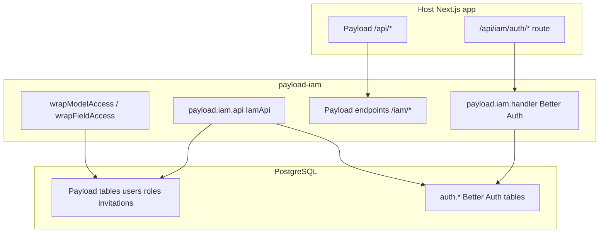

# Runtime architecture

## Initialization

1. Payload loads config; **`IAM()`** merges collections (`roles`, `invitations`, …), admin views, endpoints, and patches the users collection.
2. On **`onInit`**, the plugin runs **`ensureAuthSchema(pool)`** (schema **`auth`**) then **`createPayloadIamRuntime`**, assigning **`payload.iam.handler`** and **`payload.iam.api`**.

## Access control

- Human admins: permissions from **role documents** on `req.user` (`effectivePermissions`, `effectiveIsRoot`).
- Plugin **wraps** each host collection/global access with **`intersectAccess`** — both host and plugin must allow.
- **Root Admin** bypasses matrix checks; **caller ceiling** prevents delegating permissions broader than your own ([`ceiling.ts`](../src/modules/rbac/domain/ceiling.ts)).

## Invitations

Admin creates invite → email (or API) → user hits **`/admin/invite/accept`** → **`acceptInvite`** provisions Payload user + Better Auth account → roles applied within ceiling rules.

## Module layout

See [adr/0001-module-architecture.md](./adr/0001-module-architecture.md) and [ui-structure.md](./ui-structure.md).
